<body>

    <!-- BARRA SUPERIOR DE UBICACIÓN Y HORARIOS -->
    

        
📍 <strong>Ubicación:</strong> Zona Agroindustrial, Barquisimeto - Lara, Venezuela

        
📅 <strong>Atención:</strong> Lunes a Viernes: 8:00 AM - 4:30 PM 

    

    <!-- ENCABEZADO CON LOGO OFICIAL Y MENÚ -->
    <header>
        

            <a href="#" class="logo-box">
                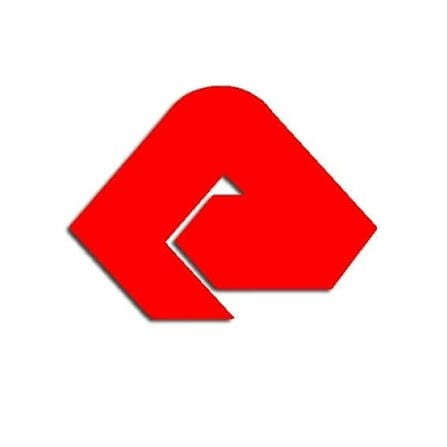
                

                    AGRÍCOLA LEÓN
                    Rif: j-31312137-1
                

            </a>

            <!--MENU DE LA PAGINA-->
            <!--Boton desplegable -->
            <input type="checkbox" id="modo-ocular">
            <label for="modo-ocular" class="btn-modo">
                
            </label>
            <input type="checkbox" id="menu-toggle">
            <label for="menu-toggle" class="menu-btn">☰</label>

            <!--lista-->
            <ul class="nav-menu">
                <li><a href="#inicio">Inicio</a></li>
                <li><a href="#servicios">Catálogo Agrotech</a></li>
                <li><a href="#sustentabilidad">Quienes Somos</a></li>
                <li><a href="#faq">Preguntas Frecuentes</a></li>
                <li><a href="#multimedia">Videos</a></li>
                <li><a href="#cotizar" class="btn-cotizar">Cotizar</a></li>
            </ul>

        

    </header>

    <!-- BANNER Y CARRUSEL -->
    <section id="descarga" class="hero-section">
        

            

            

            

        

        

            <h1>Sistemas Tecnológicos para la Agroindustria</h1>
            
Acompañamos al productor con insumos y equipos que hacen que el campo sea sustentable en el tiempo.

            <a href="Manual/usuario.docx" download="Manual de usuario" class="btn-main">Aprende a Navegar en Nuestra
                Pagina</a>
        

    </section>

    <!-- CARRUSEL DE PRODUCTOS -->
    <!-- SECCIÓN DE CARRUSEL DE CATEGORÍAS TIPO TARJETAS -->

    <section id="inicio" class="cards-carousel-section">
        

            <h2 class="titulo-seccion">Sistemas Tecnológicos para la Agroindustria</h2>
            
Acompañamos al productor con insumos y equipos que hacen que el campo sea sustentable en el
                tiempo.

        

        

            <!-- ================= PRIMERA VUELTA (7 Tarjetas) ================= -->

            <!-- Tarjeta 1: Bombas de agua -->
            <label for="cat-bombas" class="card-item">
                

                    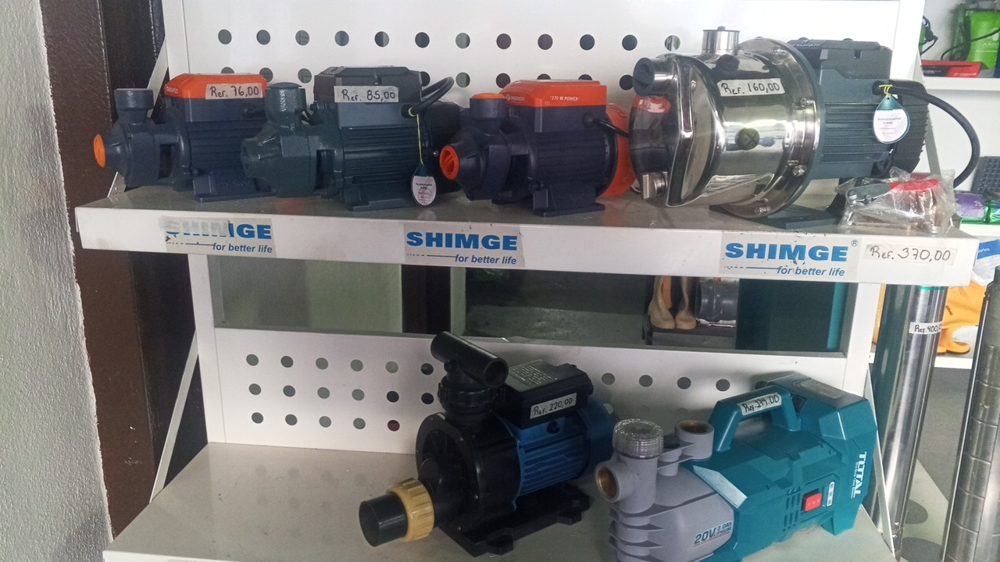
                    

                        <h3>Sistemas de Alta Presión</h3>
                        <h2>Bombas de agua</h2>
                    

                

            </label>

            <!-- Tarjeta 2: Mangueras y tuberías -->
            <label for="cat-tuberias" class="card-item">
                

                    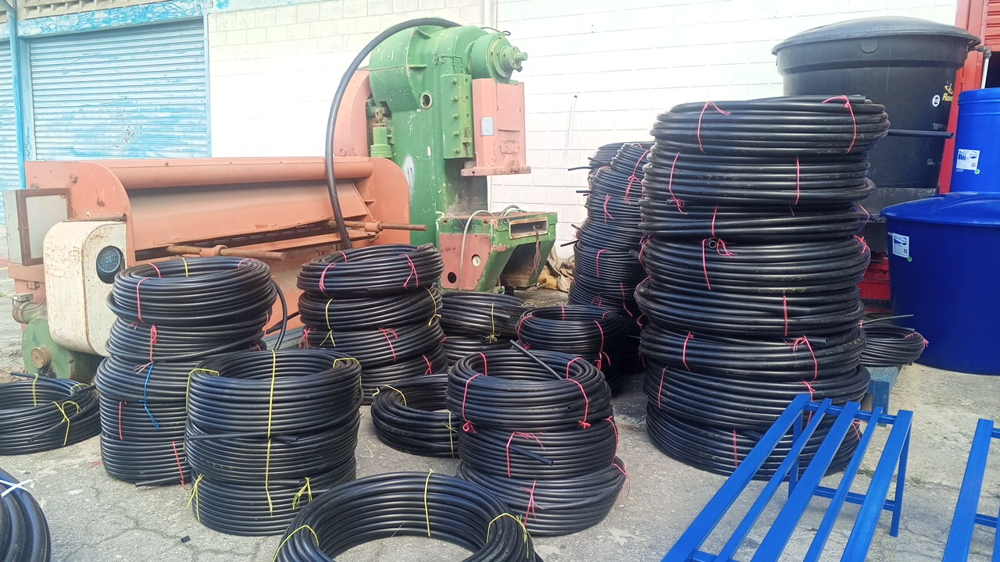
                    

                        <h3>Conducción y Riego</h3>
                        <h2>Mangueras y tuberías</h2>
                    

                

            </label>

            <!-- Tarjeta 3: Fumigadoras -->
            <label for="cat-fumigadoras" class="card-item">
                

                    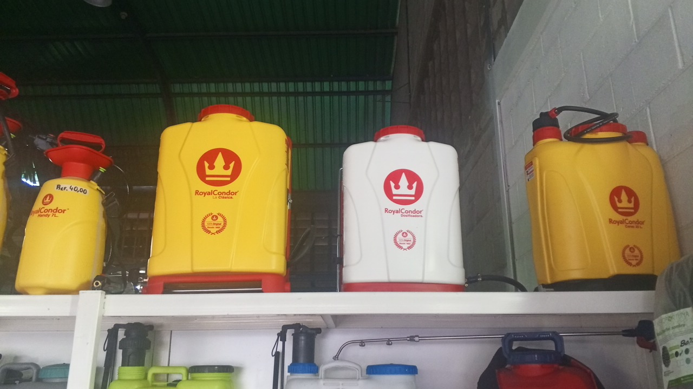
                    

                        <h3>Protección de Cultivos</h3>
                        <h2>Fumigadoras</h2>
                    

                

            </label>

            <!-- Tarjeta 4: Aspersores -->
            <label for="cat-aspersores" class="card-item">
                

                    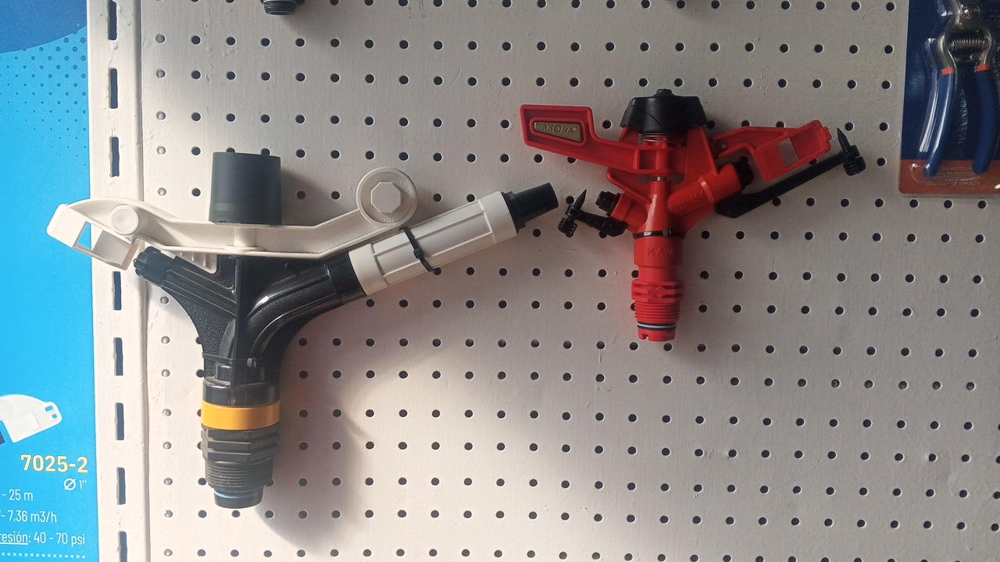
                    

                        <h3>Distribución Uniforme</h3>
                        <h2>Aspersores</h2>
                    

                

            </label>

            <!-- Tarjeta 5: Conexiones de tuberías -->
            <label for="cat-conexiones" class="card-item">
                

                    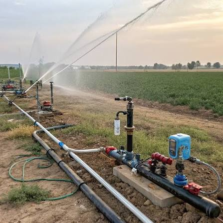
                    

                        <h3>Accesorios y Empalmes</h3>
                        <h2>Conexiones de tuberías</h2>
                    

                

            </label>

            <!-- Tarjeta 6: Fertilizantes y abono -->
            <label for="cat-fertilizante" class="card-item">
                

                    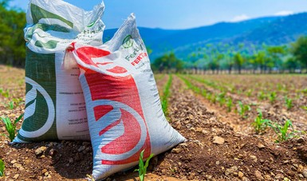
                    

                        <h3>Nutrición de Suelos</h3>
                        <h2>Fertilizantes y abono</h2>
                    

                

            </label>

            <!-- Tarjeta 7: Semillas (de todo tipo) -->
            <label for="cat-semillas" class="card-item">

                

                    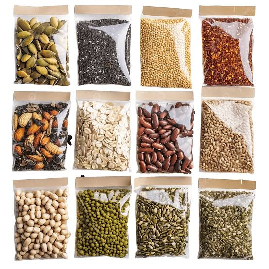
                    

                        <h3>Alto Rendimiento</h3>
                        <h2>Semillas (de todo tipo)</h2>
                    

                

                
            </label>

            <!-- ================= SEGUNDA VUELTA (Copia exacta para bucle infinito) ================= -->

            <!-- Tarjeta 1: Bombas de agua -->
            <label for="cat-bombas" class="card-item">
                

                    
                    

                        <h3>Sistemas de Alta Presión</h3>
                        <h2>Bombas de agua</h2>
                    

                

            </label>

            <!-- Tarjeta 2: Mangueras y tuberías -->
            <label for="cat-tuberias" class="card-item">
                

                    
                    

                        <h3>Conducción y Riego</h3>
                        <h2>Mangueras y tuberías</h2>
                    

                

            </label>

            <!-- Tarjeta 3: Fumigadoras -->
            <label for="cat-fumigadoras" class="card-item">
                

                    
                    

                        <h3>Protección de Cultivos</h3>
                        <h2>Fumigadoras</h2>
                    

                

            </label>

            <!-- Tarjeta 4: Aspersores -->
            <label for="cat-aspersores" class="card-item">
                

                    
                    

                        <h3>Distribución Uniforme</h3>
                        <h2>Aspersores</h2>
                    

                

            </label>

            <!-- Tarjeta 5: Conexiones de tuberías -->
            <label for="cat-conexiones" class="card-item">
                

                    
                    

                        <h3>Accesorios y Empalmes</h3>
                        <h2>Conexiones de tuberías</h2>
                    

                

            </label>

            <!-- Tarjeta 6: Fertilizantes y abono -->
            <label for="cat-fertilizante" class="card-item">
                

                    
                    

                        <h3>Nutrición de Suelos</h3>
                        <h2>Fertilizantes y abono</h2>
                    

                

            </label>

            <!-- Tarjeta 7: Semillas (de todo tipo) -->
            <label for="cat-semillas" class="card-item">

                

                    
                    

                        <h3>Alto Rendimiento</h3>
                        <h2>Semillas (de todo tipo)</h2>
                    

                

                
            </label>

        

    </section>

    <!-- CATÁLOGO DE INNOVACIONES AGROTECH CON FILTROS INTERACTIVOS EN CSS PURO -->
    <section id="servicios" class="container">
        

            <h2>Catálogo de Innovaciones Agrotech</h2>
            
Filtra nuestros insumos y dispositivos de alta precisión diseñados para la máxima durabilidad en campo.
            

        

        <!-- Inputs de radio para el filtrado en CSS puro -->
        <input type="radio" id="cat-all" name="agrotech-filter" class="chk-filtro" checked>
        <input type="radio" id="cat-bombas" name="agrotech-filter" class="chk-filtro">
        <input type="radio" id="cat-tuberias" name="agrotech-filter" class="chk-filtro">
        <input type="radio" id="cat-fumigadoras" name="agrotech-filter" class="chk-filtro">
        <input type="radio" id="cat-aspersores" name="agrotech-filter" class="chk-filtro">
        <input type="radio" id="cat-conexiones" name="agrotech-filter" class="chk-filtro">
        <input type="radio" id="cat-fertilizante" name="agrotech-filter" class="chk-filtro">
        <input type="radio" id="cat-semillas" name="agrotech-filter" class="chk-filtro">

        <!-- Botones de control del filtro -->
        

            <label for="cat-all" class="filter-btn">Todos los Productos</label>
            <label for="cat-bombas" class="filter-btn">Bombas de Agua</label>
            <label for="cat-tuberias" class="filter-btn">Mangueras y Tuberías</label>
            <label for="cat-fumigadoras" class="filter-btn">Fumigadoras</label>
            <label for="cat-aspersores" class="filter-btn">Aspersores</label>
            <label for="cat-conexiones" class="filter-btn">Conexiones de Tuberías</label>
            <label for="cat-fertilizante" class="filter-btn">Fertilizantes y Abono</label>
            <label for="cat-semillas" class="filter-btn">Semillas</label>
        

        <!-- Cuadrícula con las 7 tarjetas sincronizadas -->
        

            <!-- Tarjeta 1: Bombas de agua -->

            

                SISTEMA DE BOMBEO
                

                    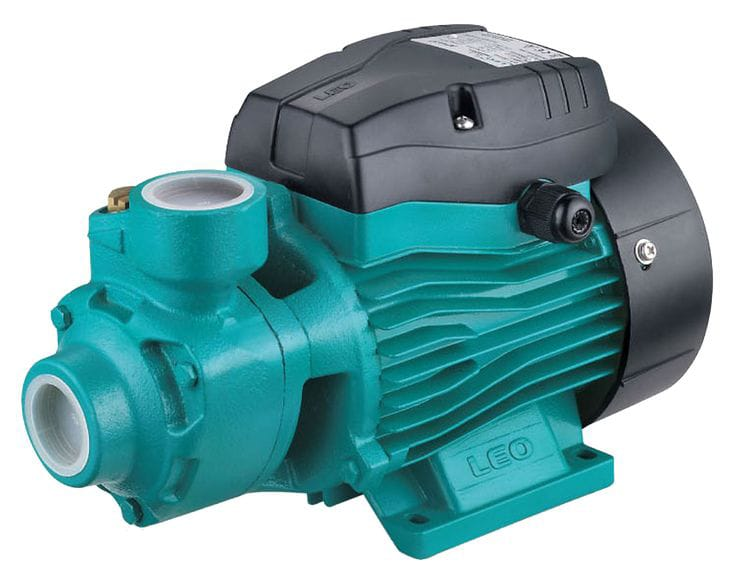
                

                

                    <h3>Bomba LEO</h3>
                    <ul>
                        <li><strong>Caballos de fuerza</strong>: Va de 0.5 HP a 3 HP en modelos domésticos (y hasta 10
                            HP en líneas industriales).</li>
                        <li><strong>Tiempo de vida</strong>: Tiene una vida útil de 5 a 10 años trabajando con agua
                            limpia y buen mantenimiento.</li>
                        <li><strong>Descripción del producto</strong>: Es una electrobomba usada para bombear agua
                            limpia en hogares, llenar tanques elevados y presurizar tuberías residenciales.</li>
                    </ul>
                

            

            

                SISTEMA DE BOMBEO
                

                    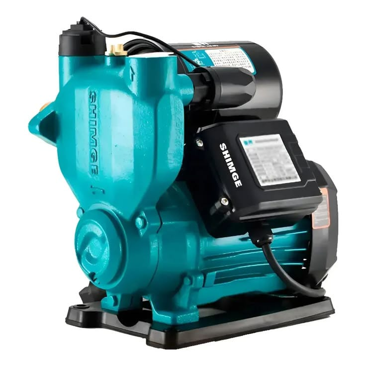
                

                

                    <h3>Bomba Shimge</h3>
                    <ul>
                        <li><strong>Caballos de fuerza</strong>: Va de 0.5 HP a 2 HP en modelos residenciales (y hasta
                            15 HP o más en bombas sumergibles e industriales).</li>
                        <li><strong>Tiempo de vida</strong>: Tiene una vida útil de 5 a 10 años operando con agua limpia
                            y protección contra picos de voltaje.</li>
                        <li><strong>Descripción del producto</strong>: Es una electrobomba utilizada para abastecer agua
                            limpia en viviendas, impulsar agua hacia tanques altos, riego ligero y sistemas
                            hidroneumáticos domésticos.</li>
                    </ul>
                

            

            

                SISTEMA DE BOMBEO
                

                    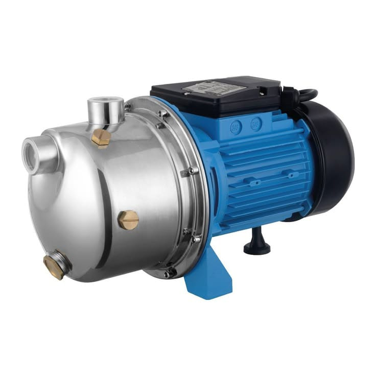
                

                

                    <h3>Bomba Pearl</h3>
                    <ul>
                        <li><strong>Caballos de fuerza</strong>:Va de 0.5 HP a 3 HP en modelos domésticos y comerciales
                            ligeros (y hasta 50 HP o más en bombas sumergibles e industriales).</li>
                        <li><strong>Tiempo de vida</strong>: Tiene una vida útil de 8 a 12 años gracias a sus materiales
                            de alta resistencia y buen mantenimiento.</li>
                        <li><strong>Descripción del producto</strong>: Es una electrobomba de gama alta utilizada para
                            suministro de agua limpia en hogares, edificios, sistemas hidroneumáticos, riego y
                            aplicaciones agrícolas o comerciales.</li>
                    </ul>
                

            

            

                SISTEMA DE BOMBEO
                

                    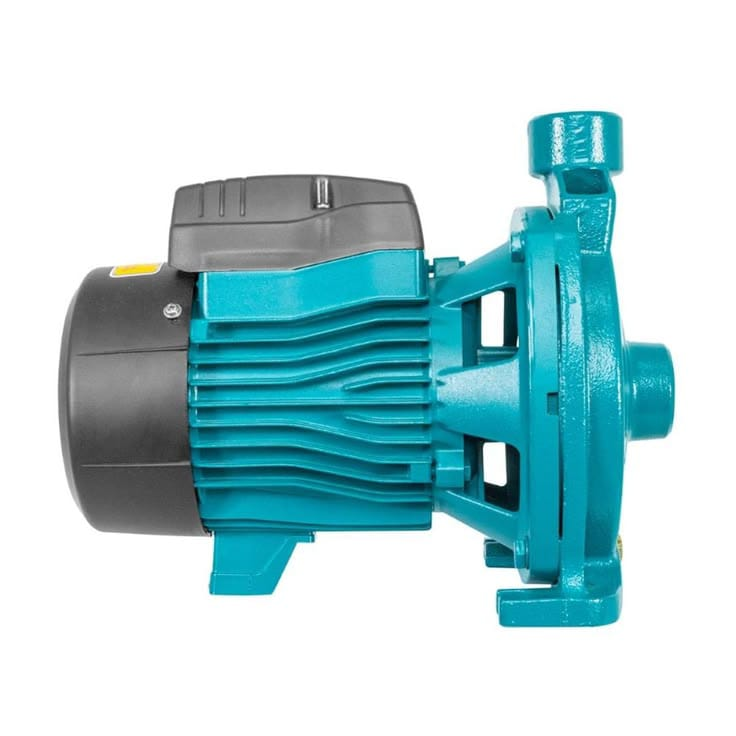
                

                

                    <h3>Bomba Sounter</h3>
                    <ul>
                        <li><strong>Caballos de fuerza</strong>:Va de 0.5 HP a 2 HP en sus modelos residenciales más
                            comunes (y hasta 5 HP o más en bombas centrífugas e industriales ligeras).</li>
                        <li><strong>Tiempo de vida</strong>:Tiene una vida útil estimada de 4 a 8 años operando con agua
                            limpia, buen mantenimiento y protección eléctrica adecuada.</li>
                        <li><strong>Descripción del producto</strong>: Es una electrobomba económica y funcional
                            utilizada para bombear agua limpia en hogares, subir agua desde cisternas a tanques elevados
                            y abastecer pequeños sistemas de riego.</li>
                    </ul>
                

            

            <!-- Tarjeta 2: Mangueras y tuberías -->
            

                TUBERÍAS
                

                    
                

                

                    <h3>Mangueras y tuberías</h3>
                    
Rollos de manguera de alta resistencia para conducción de agua en sistemas de riego por goteo y
                        tendidos de campo.

                

            

            <!-- Tarjeta 3: Fumigadoras -->
            

                FUMIGACIÓN
                

                    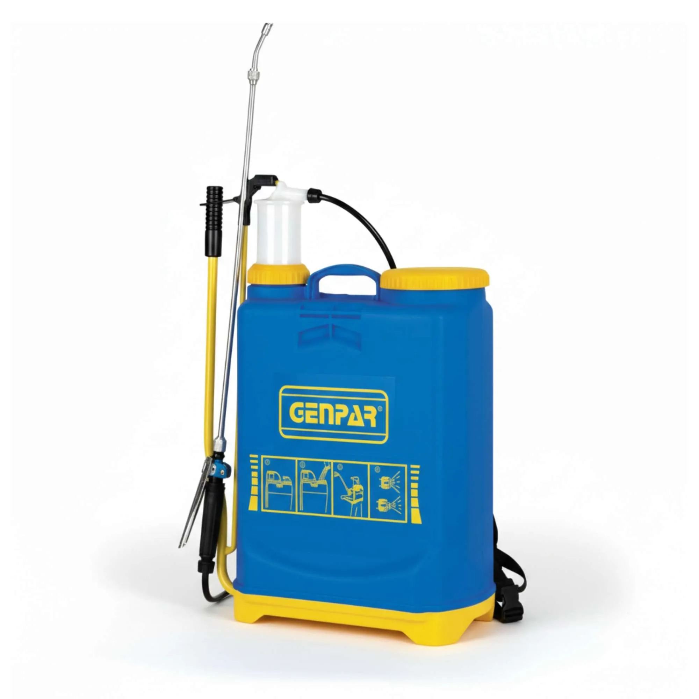
                

                

                    <h3>Fumigadora Manual de Espalda Tipo Mochila – Tanque de 20 Litros</h3>
                    <ul>
                        <li><strong>Capacidad y autonomía.</strong>: Tanque ergonómico de 20 litros fabricado en
                            polietileno de alta densidad con protección UV, ideal para jornadas continuas sin recargas
                            frecuentes.</li>
                        <li><strong>Sistema de bombeo</strong>: Palanca lateral reversible (para uso con mano derecha o
                            izquierda) con cámara de presión interna que mantiene una aspersión constante.</li>
                        <li><strong>Presión de trabajo</strong>: Opera entre 45 y 85 PSI (3 a 5.8 bar), ofreciendo un
                            alcance óptimo tanto para aplicación foliar como dirigida al suelo.</li>
                        <li><strong>Accesorios incluidos</strong>:Lanza metálica o de fibra de vidrio resistente a
                            agroquímicos, manguera reforzada, correas acolchadas y juego de boquillas intercambiables.
                        </li>
                        <li><strong>Aplicaciones ideales.</strong>: Cultivos agrícolas de mediana escala, control de
                            malezas, fertilización foliar y desinfección de galpones.</li>

                    </ul>
                

            

            

                FUMIGACIÓN
                

                    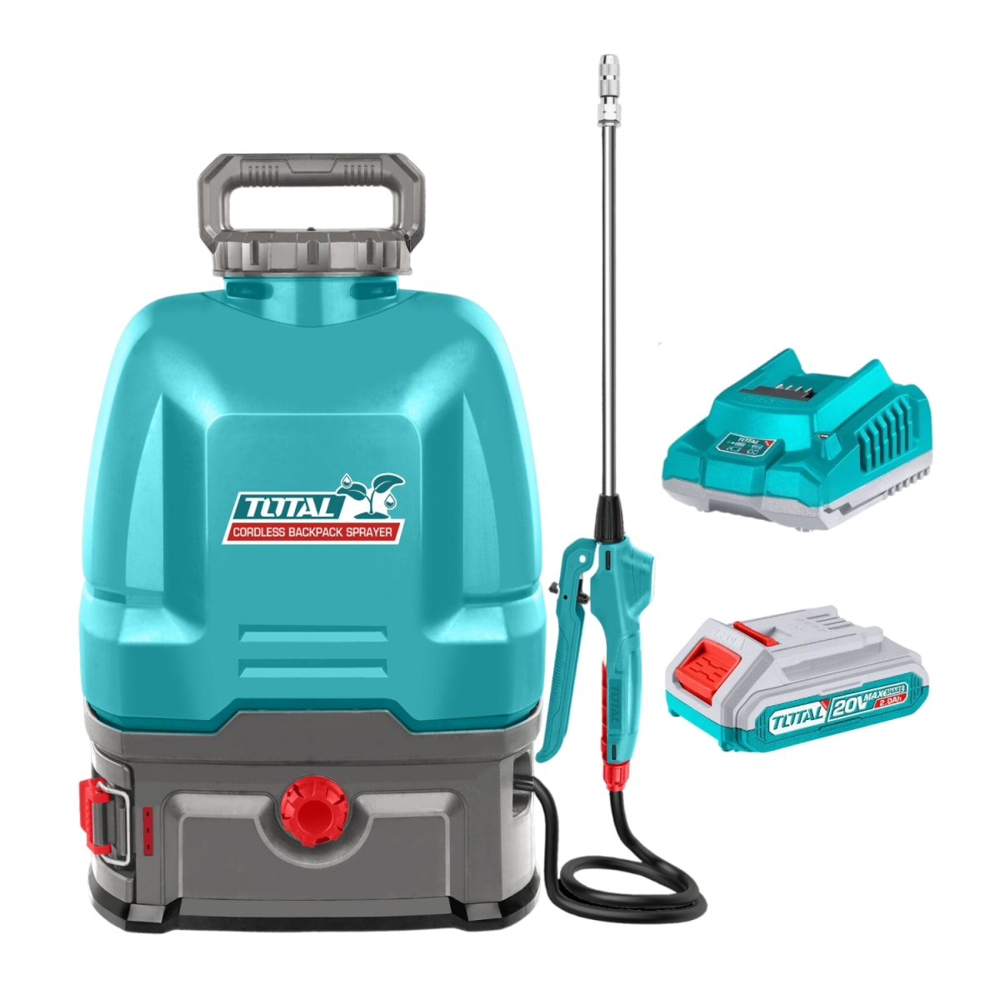
                

                

                    <h3>Fumigadora Eléctrica Inalámbrica de Mochila a Batería – 16 Litros</h3>
                    <ul>
                        <li><strong>Cero esfuerzo manual</strong>: Bomba eléctrica alimentada por batería recargable de
                            litio (12V o 20V) que elimina el bombeo continuo con palanca y reduce la fatiga del
                            operario.</li>
                        <li><strong>Capacidad del tanque</strong>: Depósito de 16 litros con boca ancha, filtro colador
                            interno y espaldar acolchado para mayor comodidad.</li>
                        <li><strong>Presión de trabajo</strong>:Mantiene un flujo uniforme de hasta 5 bar (72 PSI) con
                            regulador de velocidad para ajustar el tamaño de gota según el cultivo.</li>
                        <li><strong>Autonomía prolongada</strong>:Rinde entre 3 y 5 horas de trabajo continuo por carga
                            (equivalente a múltiples tanques pulverizados), con indicador LED de nivel de batería.
                        </li>
                        <li><strong>Aplicaciones ideales.</strong>: Invernaderos, huertos frutales, hortalizas,
                            fumigación urbana y sanitización profesional.</li>

                    </ul>
                

            

            <!-- Tarjeta 4: Aspersores -->
            

                RIEGO
                

                    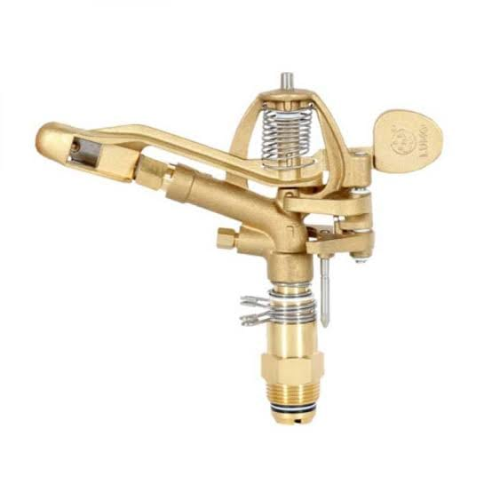
                

                

                    <h3>Aspersor de Impacto Metálico Sectorial en Bronce – Uso Agrícola</h3>
                    <ul>
                        <li><strong>Material de fabricación</strong>: Cuerpo, brazo oscilante y base fabricados en
                            bronce (latón) macizo con resortes en acero inoxidable para máxima resistencia a impactos,
                            corrosión y rayos UV.</li>
                        <li><strong>Riego sectorial o círculo completo</strong>: Incluye anillos de ajuste inferiores
                            que permiten regular el ángulo de riego desde un sector parcial (ej. 20° a 340°) hasta una
                            rotación completa de 360°.</li>
                        <li><strong>Control del chorro</strong>: Incorpora tornillo difusor superior para fraccionar el
                            chorro de agua y lograr gotas más finas en cultivos delicados o mayor alcance con viento.
                        <li><strong>Tipo de conexión</strong>: Base con rosca macho estándar (habitualmente disponible
                            en medidas de 20 mm (3/4") o 25 mm (1") según modelo) para acople directo a elevadores o
                            trípodes.</li>
                        <li><strong>Rendimiento hidráulico</strong>: Diseñado para operar con presiones medias (entre
                            2.0 y 4.5 bar / 30 a 65 PSI), cubriendo un radio de alcance amplio y uniforme.</li>
                        <li><strong>Aplicaciones ideales</strong>: Riego agrícola a campo abierto, hortalizas, pastos,
                            huertos, viveros y áreas verdes de gran extensión.</li>
                    </ul>
                

            

            

                RIEGO
                

                    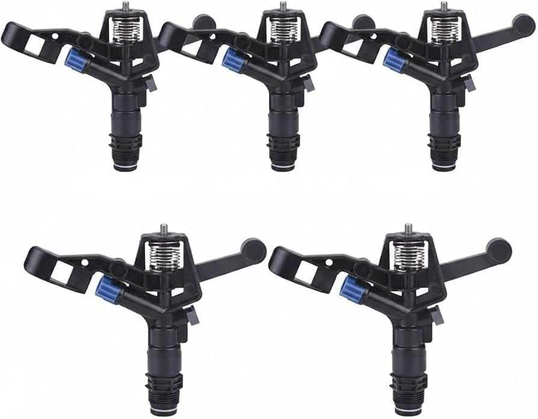
                

                

                    <h3>Aspersor de Impacto Plástico Circular – Uso Agrícola</h3>
                    <ul>
                        <li><strong>Material de fabricación</strong>: CFabricado en plástico técnico de ingeniería
                            (Delrin / poliacetal) con protección anti-UV, ligero, libre de corrosión y con resorte en
                            acero inoxidable.</li>
                        <li><strong>Cobertura de riego</strong>: Diseño de círculo completo (360°) que proporciona una
                            distribución uniforme del agua en toda el área alrededor del aspersor.</li>
                        <li><strong>Boquilla intercambiable</strong>: Incluye boquilla roscada en color azul (estándar
                            de 4.0 mm) de fácil extracción para limpieza rápida o ajuste de caudal.
                        <li><strong>Tipo de conexión</strong>: Base con rosca macho de 20 mm (3/4") para instalación
                            directa en elevadores, tubos de PVC o trípodes de riego.</li>
                        <li><strong>Rendimiento hidráulico</strong>: Opera eficientemente con presiones medias (entre
                            1.5 y 4.0 bar / 22 a 58 PSI), logrando un radio de alcance medio sin dañar cultivos
                            delicados.</li>
                        <li><strong>Aplicaciones ideales</strong>: Riego por aspersión en hortalizas, cultivos de ciclo
                            corto, viveros, jardines y pastos.</li>
                    </ul>
                

            

            

                RIEGO
                

                    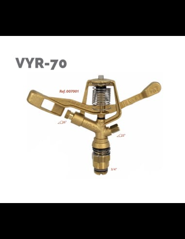
                

                

                    <h3>Aspersor de Impacto Agrícola Circular Vyrsa VYR-70 (Bronce 3/4")</h3>
                    <ul>
                        <li><strong>Material de fabricación</strong>: Cuerpo fabricado en latón (bronce), eje y resortes
                            en acero inoxidable, y juntas de teflón y policarbonato resistentes a fertilizantes
                            agresivos.</li>
                        <li><strong>Cobertura de riego</strong>: Riego circular completo (360°) con un radio de alcance
                            de 13 a 18 metros y altura máxima de chorro de 4,3 m.</li>
                        <li><strong>Doble boquilla.</strong>: Incorpora boquilla principal de largo alcance con ángulo
                            de 26° y boquilla secundaria deflectora (o tapón) de 22° para cobertura uniforme en corto
                            alcance.
                        <li><strong>Tipo de conexión</strong>: Base con rosca macho de 20 mm (3/4") para acople directo
                            en elevadores, tubos o trípodes de riego.</li>
                        <li><strong>Rendimiento hidráulico</strong>: Opera con presiones de trabajo entre 1,75 y 4,5 bar
                            (25 a 65 PSI) y entrega un caudal de 620 a 3.360 litros/hora.</li>
                        <li><strong>Aplicaciones ideales</strong>: Cultivos extensivos, cereales, hortalizas, alfalfa,
                            legumbres, tubérculos y árboles frutales.</li>
                    </ul>
                

            

            <!-- Tarjeta 5: Conexiones de tuberías -->

            

                ACCESORIOS
                

                    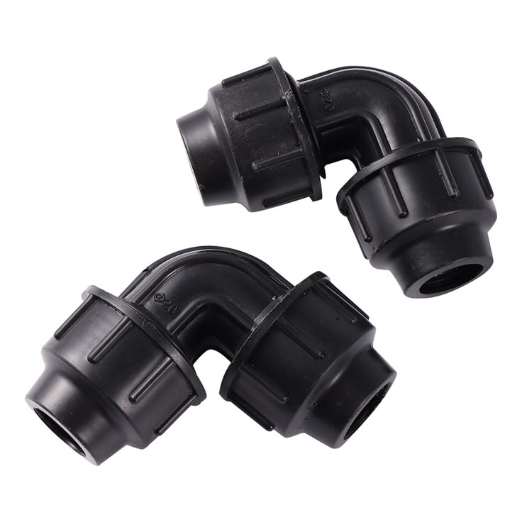
                

                

                    <h3>Codo de Compresión 90° – 20 mm</h3>
                    <ul>
                        <li><strong>Medida</strong>:20 mm (1/2 pulgada) para tubería de polietileno (PE).</li>
                        <li><strong>Instalación rápida</strong>:Ajuste manual por compresión, sin pegamentos ni
                            herramientas.</li>
                        <li><strong>Cero fugas</strong>: Tuercas de bloqueo que garantizan un sellado firme y seguro.
                        </li>
                        <li><strong>Alta durabilidad</strong>: Resistente a impactos, humedad y rayos UV (ideal para
                            exteriores).</li>
                        <li><strong>Uso ideal</strong>: Sistemas de riego por goteo, jardinería, agricultura y agua
                            fría.</li>
                    </ul>
                

            

            

                ACCESORIOS
                

                    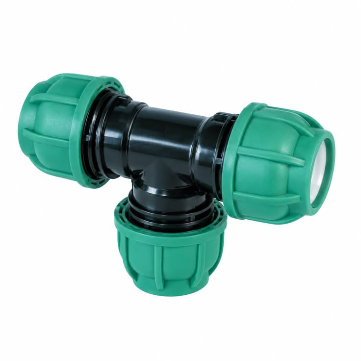
                

                

                    <h3>Tee de Compresión Igual – Tubería de Polietileno (PEAD)</h3>
                    <ul>
                        <li><strong>Medida</strong>:20 mm (1/2") / 25 mm (3/4") / 32 mm (1") para tubería de polietileno
                            (PE).</li>
                        <li><strong>Estanqueidad certificada</strong>: Junta tórica (O-ring) de caucho nitrilo (NBR) que
                            asegura cierre hermético sin deformar la pared del tubo.</li>
                        <li><strong>Distribución de caudal</strong>: Derivación en 3 vías de igual diámetro para
                            ramificar redes principales sin pérdida significativa de presión.
                        </li>
                        <li><strong>Resistencia mecánica</strong>: Tuercas verdes de polipropileno de alto impacto con
                            aditivo anti-UV para instalaciones expuestas a la intemperie.</li>
                        <li><strong>Normativa y seguridad</strong>: Apta para agua potable (material atóxico e insípido)
                            fabricada bajo estándar dimensional ISO 17885.</li>
                        <li><strong>Montaje desmontable</strong>: Permite desarmar, limpiar o ampliar la red de riego o
                            distribución hidráulica reutilizando la misma pieza.</li>
                    </ul>
                

            

            

                ACCESORIOS
                

                    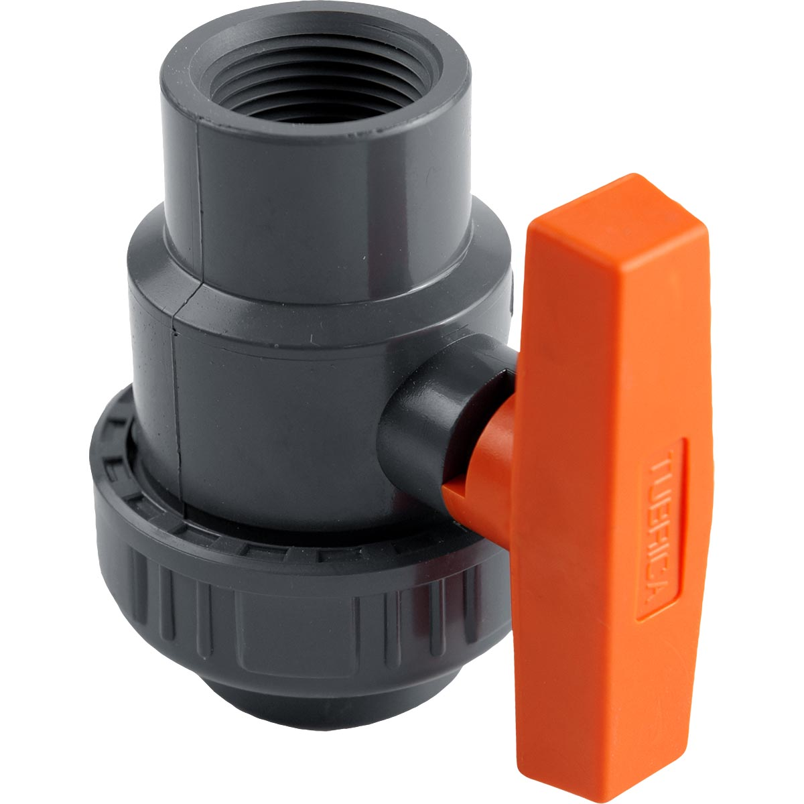
                

                

                    <h3>Válvula de Bola PVC Tipo Unión Universal (Roscada)</h3>
                    <ul>
                        <li><strong>Medida</strong>: 20 mm (1/2") / 25 mm (3/4") / 32 mm (1") con conexión Hembra
                            Roscada (HR x HR).</li>
                        <li><strong>Tipo de conexión</strong>: Hembra Roscada x Hembra Roscada (HR x HR) con rosca
                            estándar NPT (requiere cinta de teflón para su instalación).</li>
                        <li><strong>Ventaja de mantenimiento</strong>: Incluye tuerca de unión universal que permite
                            desmontar la válvula o desconectar la tubería sin tener que cortar el tubo.
                        </li>
                        <li><strong>Cierre rápido</strong>: Manilla ergonómica de cuarto de vuelta (90°) para apertura y
                            cierre total inmediato del paso de agua.</li>
                        <li><strong>Material y uso</strong>: Fabricada en PVC rígido de alta resistencia, diseñada
                            exclusivamente para sistemas de agua fría a presión (no se oxida ni corroe).</li>
                        <li><strong>Aplicaciones ideales</strong>: Bombas de agua, tanques de almacenamiento, piscinas,
                            sistemas de riego y acometidas residenciales o comerciales.</li>
                    </ul>
                

            

            

                ACCESORIOS
                

                    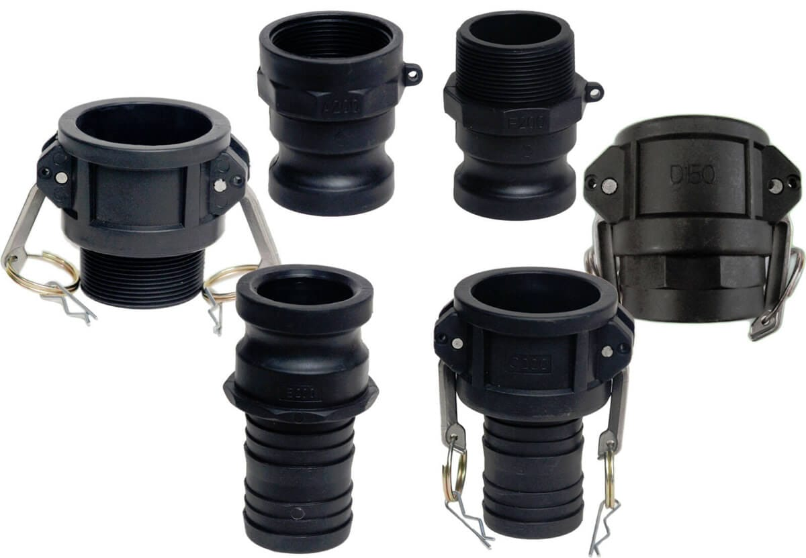
                

                

                    <h3>VAcople Rápido Tipo Camlock en Polipropileno (Tipos A, B, C, D, E y F)</h3>
                    <ul>
                        <li><strong>Medida</strong>: 20 mm (3/4") / 25 mm (1") / 40 mm (1 1/2") / 50 mm (2") / 75 mm
                            (3") / 100 mm (4").</li>
                        <li><strong>Conexión sin herramientasn</strong>:• Sistema de leva y ranura con brazos de bloqueo
                            (en acoples hembra) y pasadores de seguridad para conectar o desconectar mangueras en
                            segundos.</li>
                        <li><strong>Modelos disponibles</strong>: • Adaptadores macho (Tipos A, E, F) y acoples hembra
                            con palancas (Tipos B, C, D) con extremos roscados (NPT) o espiga para manguera.
                        </li>
                        <li><strong>Material y resistencia</strong>: Fabricados en polipropileno reforzado con fibra de
                            vidrio y empaque interno de EPDM/NBR, resistentes a químicos, fertilizantes y corrosión.
                        </li>
                        <li><strong>Aplicaciones ideales</strong>: Motobombas, camiones cisterna, sistemas de riego
                            agrícola, trasvase de agua, fertilizantes líquidos e industria.</li>
                    </ul>
                

            

            <!-- Tarjeta 6: Fertilizantes y abono -->
            

                NUTRICIÓN
                

                    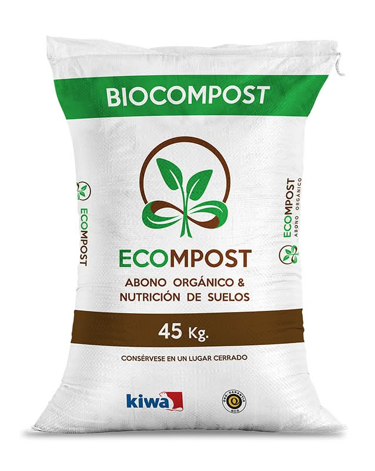
                

                

                    <h3>Abono Orgánico Biocompost Ecompost – Saco de 45 Kg</h3>
                    
Es un abono orgánico maduro con certificación ecológica internacional, rico en materia orgánica
                        estable, macro y micronutrientes, además de un complejo microbiano activo que reactiva suelos
                        fatigados, erosionados o pobres.
                    

                

            

            

                NUTRICIÓN
                

                    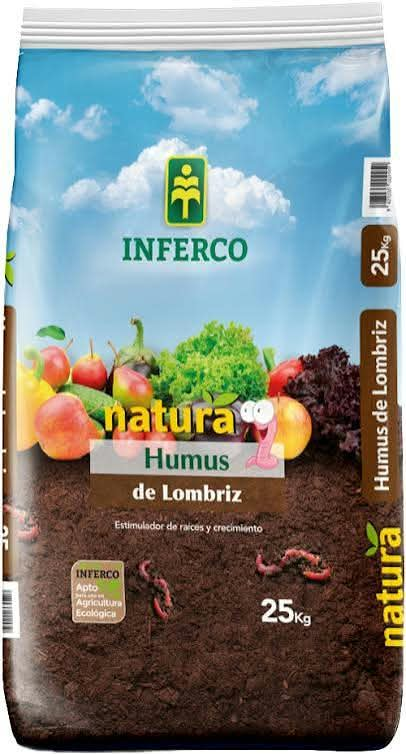
                

                

                    <h3>Abono Orgánico Humus de Lombriz Inferco Natura – Saco de 25 Kg</h3>
                    
Humus sólido de alta pureza apto para agricultura ecológica. Destaca por su altísima
                        concentración de ácidos húmicos y fúlvicos, así como flora microbiana benéfica que actúa como un
                        potente estimulador del enraizamiento y desbloqueador de nutrientes del suelo.
                    

                

            

            

                NUTRICIÓN
                

                    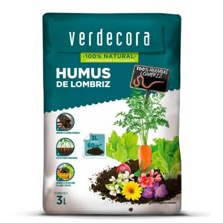
                

                

                    <h3>Abono Orgánico Humus de Lombriz Verdecora – Bolsa de 3 L</h3>
                    
Enmienda 100 % natural resultante de la digestión de la lombriz roja californiana. Posee un pH
                        neutro y un excelente equilibrio que mejora la aireación en suelos pesados (arcillosos) y
                        aumenta la retención de humedad en suelos arenosos.
                    

                

            

            

                NUTRICIÓN
                

                    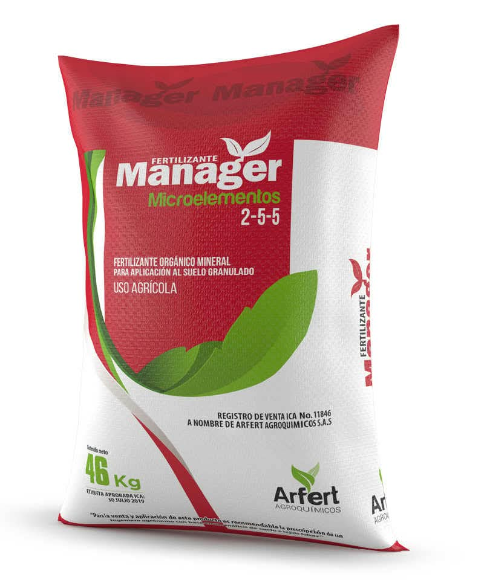
                

                

                    <h3>Fertilizante Orgánico Mineral Manager Microelementos 2-5-5 – Saco de 46 Kg</h3>
                    
Fertilizante órgano-mineral granulado de uso agrícola. Su fórmula (2 % Nitrógeno, 5 % Fósforo, 5
                        % Potasio) está enriquecida con elementos menores esenciales, lo que lo hace ideal para corregir
                        deficiencias nutricionales ocultas, mejorar el cuajado de flores y dar calidad al fruto sin
                        salinizar excesivamente el suelo.
                    

                

            

            

                NUTRICIÓN
                

                    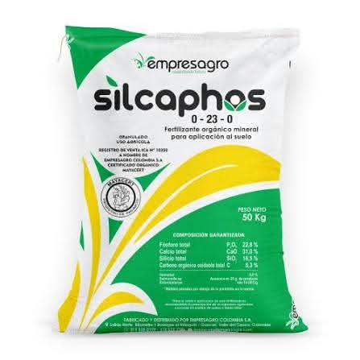
                

                

                    <h3>Fertilizante Orgánico Mineral Empresagro Silcaphos 0-23-0 – Saco de 50 Kg</h3>
                    
Fertilizante órgano-mineral granulado certificado para uso orgánico, con un altísimo aporte de
                        Fósforo (22,8 %), Calcio (31 %) y Silicio (16,5 %), además de carbono orgánico. El fósforo y el
                        calcio impulsan un sistema radicular fuerte, mientras que el silicio engrosa las paredes
                        celulares de la planta, haciéndola mucho más resistente al ataque de plagas, hongos y estrés por
                        calor.
                    

                

            

            

                NUTRICIÓN
                

                    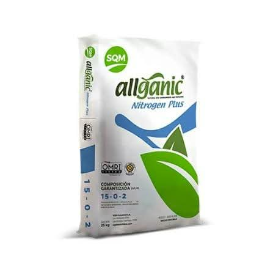
                

                

                    <h3>Fertilizante Orgánico SQM Allganic Nitrogen Plus 15-0-2 – Saco de 25 Kg</h3>
                    
Fertilizante natural de origen mineral (nitrato de sodio natural de Chile) aprobado para
                        agricultura orgánica (certificación OMRI). Aporta 15 % de Nitrógeno en forma nítrica (de
                        asimilación inmediata por la raíz, sin depender de la temperatura del suelo) y 2 % de Potasio.
                        Es excelente para dar un impulso rápido de crecimiento foliar y verdor.
                    

                

            

            <!-- Tarjeta 7: Semillas -->
            

                ALTO RENDIMIENTO
                

                    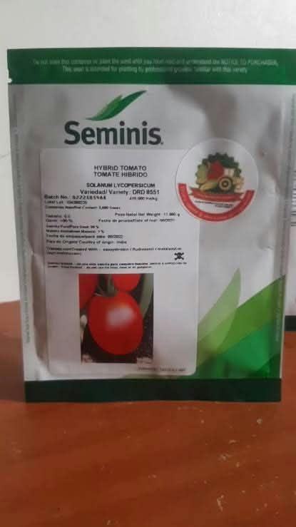
                

                

                    <h3>Semillas de Tomate</h3>
                    <ul>
                        <li>Tiene un excelente rendimiento en ciclos largos y una gran resistencia a enfermedades
                            comunes (como el virus del mosaico o la "chocolatera").</li>
                        <li>Sus frutos, del tipo chonto, son grandes, muy uniformes y de excelente consistencia.</li>
                        <li>Para su óptimo desarrollo, requiere de climas templados a cálidos y suelos profundos,
                            fértiles, ricos en materia orgánica y con muy buen drenaje.
                        </li>
                        <li>Se cultiva principalmente a campo abierto, necesitando abundante luz solar y un riego
                            constante y controlado para evitar el encharcamiento.
                        </li>

                    </ul>
                

            

            

                ALTO RENDIMIENTO
                

                    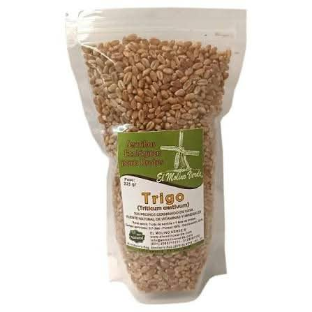
                

                

                    <h3>Semillas de Trigo</h3>
                    <ul>
                        <li>Si se destinan a la siembra tradicional en tierra para obtener la planta, el trigo prefiere
                            climas templados o fríos (de invierno o primavera, según la época) y se adapta muy bien a
                            suelos arcillosos o francos, bien estructurados, ricos en nutrientes (especialmente
                            nitrógeno y potasio) y con buena retención de humedad sin llegar a saturarse.</li>
                        <li>Requiere una profundidad de siembra ligera (de 1 a 2 cm) y abundante exposición a la luz
                            solar directa.</li>

                    </ul>
                

            

            

                ALTO RENDIMIENTO
                

                    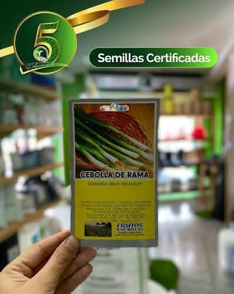
                

                

                    <h3>Semillas de Cebollas de Ramos</h3>
                    <ul>
                        <li>Esta variedad no forma bulbos, sino un tallo blanco y alargado muy apreciado en la cocina.
                        </li>
                        <li>Crece de manera óptima en climas de templados a fríos y se desarrolla con total plenitud en
                            suelos sueltos, ricos en materia orgánica, ligeramente ácidos y con excelente drenaje.</li>
                        <li>Demanda una humedad constante en el sustrato, por lo que requiere riegos frecuentes y un
                            suelo bien abonado para asegurar un crecimiento vigoroso y múltiples deshijes.</li>
                    </ul>
                

            

            

                ALTO RENDIMIENTO
                

                    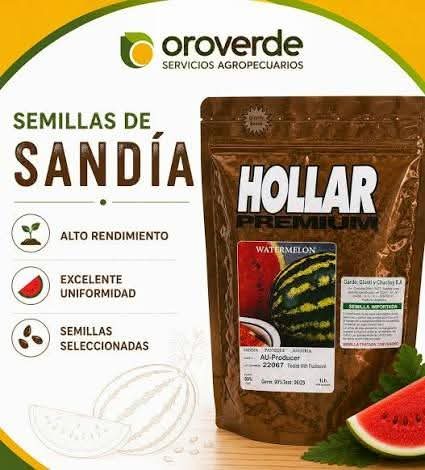
                

                

                    <h3>Semillas de Sandia</h3>
                    <ul>
                        <li>Son de calidad seleccionada y alto rendimiento, ofreciendo una excelente uniformidad en el
                            tamaño y dulzor de sus frutos.
                        </li>
                        <li>La sandía prospera en climas cálidos y con alta insolación, siendo muy sensible al frío.
                        </li>
                        <li>Requiere suelos profundos, sueltos, ricos en materia orgánica y con un drenaje perfecto, ya
                            que no tolera el encharcamiento.</li>
                        <li>Necesita bastante espacio para extenderse, riegos abundantes durante el crecimiento del
                            fruto y una temperatura cálida constante.</li>
                    </ul>
                

            

            

                ALTO RENDIMIENTO
                

                    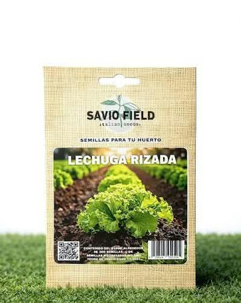
                

                

                    <h3>Semillas de Lechuga</h3>
                    <ul>
                        <li>Está diseñada especialmente para huertos urbanos y caseros, ofreciendo una rápida
                            germinación y un crecimiento vigoroso.
                        </li>
                        <li>Para su siembra, se adapta mejor a climas templados a frescos, ya que el calor excesivo
                            puede provocar que florezca prematuramente y amargue.
                        </li>
                        <li>Es ideal para cultivar en camas de siembra, macetas o huertos directos, requiriendo
                            semisombra en climas calurosos y riegos constantes y ligeros.</li>
                    </ul>
                

            

        

    </section>

    <!-- MISIÓN Y VISIÓN SUSTENTABLE -->
    <section id="sustentabilidad" class="container">
        

            

                <h2>Quienes Somos y Hacia Donde Vamos</h2>
                

                    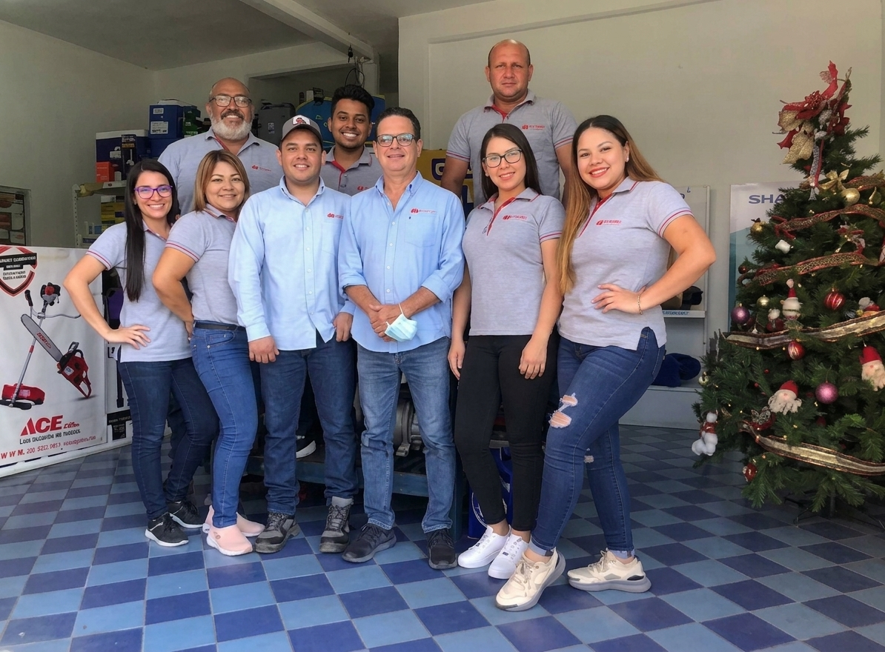
                

                
Nuestra visión estratégica para el desarrollo de la agroindustria

                

                    

                        <h3>🌱 Misión</h3>
                        
Brindar a los productores e industrias del campo equipos tecnológicos, insumos y asesoría
                            especializada, asegurando que sus siembras sean <strong>sustentables y rentables en el
                                tiempo</strong>.

                    

                    

                        <h3>🚜 Visión</h3>
                        
Convertirnos en la empresa referente en agroindustria e innovación tecnológica para el sector
                            agrícola, impulsando prácticas eficientes en el uso del agua y la tierra.

                    

                

            

    </section>

    <!-- SECCIÓN DE PREGUNTAS FRECUENTES (FAQ) -->
    <section id="faq" class="container">
        

            

                RESOLVIENDO DUDAS
            

            

                <h2>Preguntas Frecuentes</h2>
                
Respuestas rápidas sobre la implementación de nuestras tecnologías agrícolas.

            

            

                

                    
¿Cómo funcionan los sensores de suelo en terrenos con poca señal telefónica?

                    

                        Nuestras estaciones de monitoreo agrícola cuentan con memorias internas de almacenamiento
                        continuo e integran módulos de transmisión LoRaWAN de largo alcance, permitiriendo transmitir
                        la lectura de humedad y temperatura hasta un concentrador central instalado en la casa de campo
                        o bodega principal sin depender de la señal celular.
                    

                

                

                    
¿Los bioinsumos son compatibles con fertilizantes químicos tradicionales?

                    

                        Sí, la mayoría de nuestros bioinsumos y enraizadores orgánicos están formulados para
                        complementar los
                        planes de fertilización sintética tradicional, ayudando a regenerar la microbiota del suelo y
                        optimizando
                        la absorción de nutrientes por parte de la planta.
                    

                

                

                    
¿Cuánto tiempo toma la instalación de un sistema de riego automatizado?

                    

                        Dependiendo de la extensión del terreno y el relieve del campo, las instalaciones de bomba de
                        agua,
                        tuberías y líneas de microaspersión o goteo para parcelas medianas se completan entre 3 a 5 días
                        hábiles,
                        incluyendo pruebas de presión y calibración de válvulas.
                    

                

                

                    
¿Realizan envíos o atención técnica directa a finca?

                    

                        Contamos con transporte propio e ingenieros agrónomos de campo para realizar inspecciones
                        técnicas,
                        despachos directos e instalación de equipos en todo el estado Lara y regiones agrícolas vecinas.
                    

                

            

        

    </section>

    <!-- VIDEOS RELACIONADOS -->
    <section id="multimedia" class="container">
        

            <h2>Videos Relacionados</h2>
            
Conoce la tecnología que implementamos en el sector agroindustrial

        

        

            

                <video src="videos/sobre A.L.mp4" title="Quienes Somos" controls loop autoplay muted
                    playsinline></video>
            

            

                <video src="Videos/venta.mp4" title="Tecnología Agrícola" controls loop autoplay muted
                    playsinline></video>
            

            

                <video src="Videos/Manejo de plagas.mp4" title="Que Promocionamos" controls loop autoplay muted
                    playsinline></video>
            

        

    </section>

    <!-- FORMULARIO DE COTIZACIÓN -->
    <section id="cotizar" class="container">
        

            <h2>Formulario de Cotización</h2>
            
Completa los datos para recibir información sobre insumos o proyectos de riego

        

        

            <form action="#" method="POST"
                onsubmit="event.preventDefault(); alert('¡Gracias por comunicarte con Agrícola León!');">
                

                    

                        <label for="fullname">Nombre Completo *</label>
                        <input type="text" id="fullname" name="fullname" placeholder="Tu nombre" required>
                    

                    

                        <label for="phone">Teléfono de Contacto *</label>
                        <input type="tel" id="phone" name="phone" placeholder="0412-1234567" required>
                    

                    

                        <label for="subject">Asunto *</label>
                        <input type="text" id="subject" name="subject" placeholder="Ej: Cotización de Bomba de Agua"
                            required>
                    

                    

                        <label for="product">Producto a Comprar / Servicio</label>
                        <select id="product" name="product" required>
                            <option value="" disabled selected>Seleccione un producto</option>
                            <option value="bombas">Bombas de Agua Shimge</option>
                            <option value="aspersores">Aspersores de Riego</option>
                            <option value="mangueras">Mangueras y Tuberías PE</option>
                            <option value="fumigadoras">Fumigadoras Royal Condor</option>
                        </select>
                    

                    

                        <label for="solution">Solución de Interés o Detalles</label>
                        <textarea id="solution" name="solution" rows="4"
                            placeholder="Cuéntanos sobre tu cultivo o requerimiento específico..." required></textarea>
                    

                

                <button type="submit" class="btn-submit">Enviar Cotización</button>
            </form>
        

    </section>

    <!-- PIE DE PÁGINA (FOOTER), REDES SOCIALES Y CONTACTO DIRECTO -->
    <footer>
        

            

                

                    <h4>Información de la Empresa</h4>
                    

                        
<strong>🏢 Empresa:</strong> Agrícola León C.A.

                        
<strong>🕒 Atención:</strong> Lunes a Viernes

                        
<strong>⏰ Horarios:</strong> 7:30 AM - 4:30 PM

                        
<strong>📞 WhatsApp:</strong> <a href="https://wa.me/04145251984" target="_blank"
                                class="link-wa">+58 4145251984</a>

                        
<strong>✉️ Correo:</strong> contacto@agricolaleon.com

                    

                

                <!-- CONTACTO DIRECTO / WHATSAPP DESTACADO -->
                

                    <h4>Contacto Directo</h4>
                    

                        <h5>¿Atención Inmediata?</h5>
                        
Escríbenos directamente a nuestra central telefónica vía WhatsApp.

                        <a href="https://wa.me/584145198374" target="_blank" class="btn-whatsapp-direct">
                            💬 Abrir WhatsApp
                        </a>
                    

                

                

                    <h4>Redes Sociales</h4>
                    
Síguenos en nuestras plataformas oficiales:

                    

                        <a href="https://www.facebook.com/profile.php?id=100063913070865&mibextid=rS40aB7S9Ucbxw6v"
                            target="_blank" class="social-btn btn-facebook">Facebook</a>
                        <a href="https://www.instagram.com/agricolaleon.bqto?xtok=OXQxb2ZxdDJpMTNn" target="_blank"
                            class="social-btn btn-instagram">Instagram</a>
                        <a href="https://www.tiktok.com/@agricolaleon?_r=1&_t=ZS-9AtVPg8bUym" target="_blank"
                            class="social-btn btn-tiktok">TikTok</a>
                    

                

            

            

                &copy; 2026 Agrícola León C.A. - Todos los derechos reservados.
            

        

    </footer>

</body>

</html>
